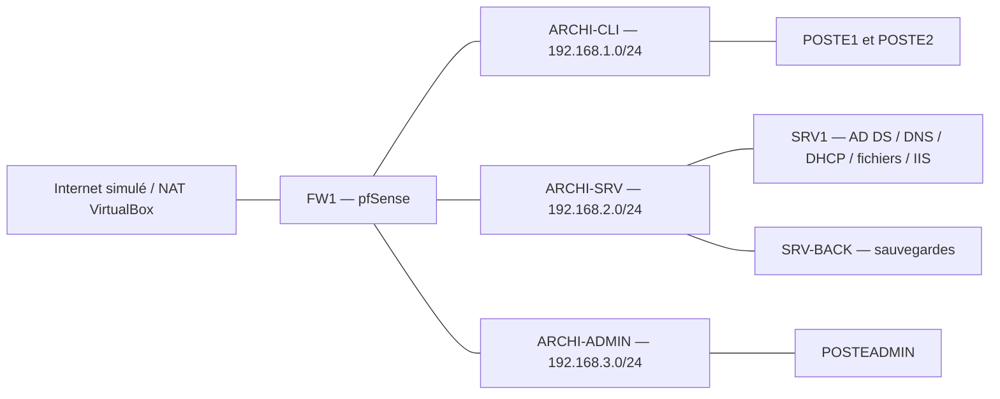

# ArchiTech — Recréer une infrastructure de PME

Projet pédagogique pour un cabinet fictif d'architecture et de BTP de 25 collaborateurs : réseau segmenté, domaine Windows, comptes et droits centralisés, fichiers partagés, site interne et sauvegardes.

**Aucune VM n'est fournie.** Ce guide explique comment reconstruire le laboratoire depuis des ISO officiels. Les mots de passe, comptes réels, disques, instantanés et exports de configuration ne sont pas publiés.

## Ce qui vient du projet et ce que propose ce guide

Le dossier technique historique décrit pfSense, Windows Server 2022, deux clients, un poste admin et un serveur de sauvegarde. Il fournit le domaine `architect.local` et trois sous-réseaux. Il contient aussi des incohérences de réseaux VirtualBox et des règles trop permissives.

Ce README propose une reconstruction cohérente avec des réseaux internes nommés et des règles explicites. Les ressources VM et la plage DHCP ci-dessous sont des choix pour cette reconstruction. Les étapes n'ont pas été rejouées de bout en bout sur des VM pendant la publication : les résultats attendus ne constituent pas des tests déjà réussis.

## 1. Ce qu'on va construire



Les repères historiques VLAN 10/20/30 correspondent ici à trois segments séparés. Ce guide n'utilise pas de trunk 802.1Q : chaque segment est un réseau interne VirtualBox distinct.

| Machine | Contenu / rôle |
|---|---|
| FW1 | Routage, filtrage, NAT sortant et relais DHCP |
| SRV1 | Domaine Active Directory, DNS, DHCP, partage Architectes et site IIS |
| SRV-BACK | Serveur membre du domaine et destination SMB des sauvegardes |
| POSTE1 / POSTE2 | Postes Windows membres du domaine, comptes fictifs |
| POSTEADMIN | Poste Windows pour administrer le laboratoire |

## 2. Préparer son ordinateur et les médias

Installer [VirtualBox](https://www.virtualbox.org/), télécharger les médias depuis [Netgate/pfSense](https://www.pfsense.org/download/) et le [centre d'évaluation Microsoft](https://www.microsoft.com/evalcenter/). Utiliser ses licences ou évaluations selon leurs conditions.

Prévoir la virtualisation matérielle activée, de l'espace pour les disques et instantanés, et assez de RAM. Pour lancer les six VM avec les allocations proposées, viser 32 Go de RAM hôte et environ 250 à 350 Go libres ; arrêter les postes secondaires pendant la préparation si nécessaire.

Windows Server doit être installé avec **Desktop Experience** pour suivre les consoles graphiques. Les postes doivent utiliser une édition permettant la jointure de domaine, telle que Pro ou Enterprise, pas Home. Le projet initial utilisait Windows 10 ; pour une nouvelle reconstruction choisir des versions prises en charge et respecter leurs prérequis, notamment TPM/UEFI pour Windows 11.

| VM | CPU proposés | RAM proposée | Disque proposé |
|---|---:|---:|---:|
| FW1 | 2 | 2 Go | 20 Go |
| SRV1 | 2 | 4 Go | 60 Go |
| SRV-BACK | 2 | 4 Go | 60 Go + capacité selon les données |
| POSTE1 | 2 | 4 Go | 64 Go ou minimum de l'OS |
| POSTE2 | 2 | 4 Go | 64 Go ou minimum de l'OS |
| POSTEADMIN | 2 | 4 Go | 64 Go ou minimum de l'OS |

Créer chaque VM avec **Nouvelle**, sélectionner l'OS et l'ISO, choisir une installation manuelle si besoin, puis créer un disque dynamique. Installer les OS et définir ses propres mots de passe, conservés hors de GitHub. Ne pas fabriquer les autres Windows en clonant un contrôleur de domaine déjà promu.

## 3. Connecter correctement les VM

Éteindre les VM avant de modifier leurs cartes dans **Configuration → Réseau**. Cocher **Carte activée** et **Câble branché**.

| VM / carte | Mode VirtualBox | Nom exact du réseau |
|---|---|---|
| FW1 carte 1 | NAT simple | WAN, pas de réseau interne |
| FW1 carte 2 | Réseau interne | ARCHI-ADMIN |
| FW1 carte 3 | Réseau interne | ARCHI-CLI |
| FW1 carte 4 | Réseau interne | ARCHI-SRV |
| SRV1 et SRV-BACK carte 1 | Réseau interne | ARCHI-SRV |
| POSTE1 et POSTE2 carte 1 | Réseau interne | ARCHI-CLI |
| POSTEADMIN carte 1 | Réseau interne | ARCHI-ADMIN |

Les noms doivent être identiques sur les machines d'un même segment. Désactiver les autres cartes Windows : une carte NAT directe contournerait FW1. Ne pas créer de redirection de port sur le NAT de VirtualBox. L'hôte n'a pas besoin d'une carte dans ces réseaux internes ; l'administration se fait depuis POSTEADMIN.

Ce choix évite les conflits d'IP entre une carte hôte et les passerelles du dossier d'origine. [Documentation réseau VirtualBox](https://www.virtualbox.org/manual/ch06.html).

## 4. Installer et configurer FW1

1. Démarrer FW1 sur le média pfSense, installer sur le disque virtuel et retirer l'ISO au redémarrage.
2. Dans la console, utiliser **Assign Interfaces**. Comparer les MAC affichées avec celles des cartes VirtualBox : les noms em0/em1 ou similaires ne doivent pas être devinés.
3. Affecter WAN à la carte 1, LAN à la carte 2 ADMIN, OPT1 à la carte 3 CLI et OPT2 à la carte 4 SRV.
4. Avec **Set interface(s) IP address**, mettre WAN en DHCP et LAN à `192.168.3.1/24`. Ne pas activer de serveur DHCP pfSense sur LAN.
5. Installer POSTEADMIN et configurer sa carte IPv4 à `192.168.3.10`, masque `255.255.255.0`, passerelle `192.168.3.1`. Pour cela : ouvrir les propriétés de la carte dans `ncpa.cpl`, puis celles d'IPv4.
6. Depuis POSTEADMIN, ouvrir `https://192.168.3.1`. Vérifier qu'il s'agit de son FW1, établir la confiance du certificat de laboratoire selon la procédure appropriée, terminer l'assistant et définir son propre mot de passe d'administration.
7. Dans **Interfaces**, activer OPT1/OPT2, les renommer CLI/SRV et leur attribuer les adresses suivantes.

| Interface | Adresse | Passerelle amont |
|---|---|---|
| WAN | Obtenue par DHCP VirtualBox | Fournie sur WAN |
| LAN / ADMIN | 192.168.3.1/24 | Aucune |
| OPT1 / CLI | 192.168.1.1/24 | Aucune |
| OPT2 / SRV | 192.168.2.1/24 | Aucune |

Le WAN reçoit une adresse privée derrière le NAT VirtualBox. Si le blocage des sources privées WAN gêne ce laboratoire, adapter **Block private networks** uniquement sur cette interface WAN virtuelle ; cela ne constitue pas une configuration à recopier sur un WAN public. Aucun accès d'administration depuis WAN n'est prévu. [Assistant pfSense](https://docs.netgate.com/pfsense/en/latest/config/setup-wizard.html).

## 5. Adresser et nommer les Windows

Sur chaque Windows statique, régler les propriétés IPv4 de sa carte. Renommer les ordinateurs comme dans le tableau puis redémarrer avant d'installer les rôles.

| Machine | Adresse | Passerelle | DNS après promotion de SRV1 |
|---|---|---|---|
| SRV1 | 192.168.2.10/24 | 192.168.2.1 | 192.168.2.10 |
| SRV-BACK | 192.168.2.20/24 | 192.168.2.1 | 192.168.2.10 |
| POSTEADMIN | 192.168.3.10/24 | 192.168.3.1 | 192.168.2.10 |
| POSTE1 / POSTE2 | DHCP ensuite | 192.168.1.1 | 192.168.2.10 |

Le masque /24 signifie `255.255.255.0`. Sur SRV1, le DNS pointant vers lui-même sera fonctionnel après création du domaine. Avant cette étape, l'absence de résolution du domaine est normale.

Avant les essais entre segments, préparer les règles de l'étape suivante. Une absence de ping ne démontre pas seule une panne : le pare-feu Windows peut bloquer ICMP.

## 6. Autoriser les flux nécessaires dans pfSense

Dans **Firewall → Aliases**, créer des alias pour SRV1, SRV-BACK, POSTEADMIN et les trois réseaux. Dans **Firewall → Rules**, placer chaque règle sur l'interface **qui reçoit le trafic de la source**. Enregistrer, appliquer et examiner les journaux. Les réponses aux connexions autorisées sont gérées par le suivi d'état. [Règles pfSense](https://docs.netgate.com/pfsense/en/latest/firewall/configure.html).

| Interface d'entrée | Source | Destination | Autorisations prévues |
|---|---|---|---|
| ADMIN | POSTEADMIN | Adresse ADMIN de FW1 | HTTPS TCP 443 |
| ADMIN | POSTEADMIN | SRV1 | DNS/AD ci-dessous ; RDP TCP 3389 si activé |
| ADMIN | POSTEADMIN | SRV-BACK | RDP TCP 3389 si activé, SMB TCP 445 si nécessaire |
| CLI | Réseau CLI | SRV1 | DNS/AD ci-dessous, SMB TCP 445, IIS TCP 80 |
| CLI | Postes autorisés à sauvegarder | SRV-BACK | SMB TCP 445 |
| Selon le besoin | Sources prévues | Cibles précises | ICMP de diagnostic limité |

Pour les membres du domaine vers SRV1 : DNS TCP/UDP 53, Kerberos TCP/UDP 88, NTP UDP 123, RPC TCP 135, LDAP TCP/UDP 389, SMB TCP 445, changement de mot de passe TCP/UDP 464 et RPC dynamique TCP 49152–65535. Ajouter TCP 3268 si le catalogue global est utilisé ; 636/3269 uniquement si LDAPS est configuré. Limiter ces autorisations à SRV1. [Ports AD Microsoft](https://learn.microsoft.com/en-us/troubleshoot/windows-server/active-directory/config-firewall-for-ad-domains-and-trusts).

Le relais DHCP utilise UDP 67/68 ; vérifier les règles automatiques de la version pfSense et les règles DHCP sur SRV1. Les échanges SRV1 ↔ SRV-BACK restent sur le même réseau et ne passent pas par FW1 : leurs limites relèvent des pare-feu Windows et des droits.

Préserver l'accès HTTPS d'administration avant de retirer une règle large existante. Le LAN par défaut peut avoir une autorisation vers n'importe quelle destination : la remplacer après validation de l'accès et préparation de la console de secours. La règle anti-verrouillage est distincte. Les interfaces optionnelles, elles, bloquent par défaut les flux non autorisés.

CLI ne doit pas administrer FW1 ni accéder à POSTEADMIN en RDP. Journaliser et tester les refus. Conserver les pare-feu Windows actifs et les règles de rôles adaptées au profil Domaine.

L'accès Internet général n'est pas nécessaire pour comprendre le scénario. Pour les mises à jour, ajouter les sorties nécessaires aux systèmes et au résolveur choisi selon son environnement ; ne pas laisser une règle temporaire Any vers Any comme résultat final.

## 7. SRV1 : créer le domaine AD et le DNS

Dans **Windows PowerShell administrateur de SRV1** :

```powershell
Install-WindowsFeature AD-Domain-Services -IncludeManagementTools
Install-ADDSForest -DomainName 'architect.local' -DomainNetbiosName 'ARCHITECT' -InstallDNS
```

Choisir le mot de passe DSRM à l'invite, le conserver en privé et accepter le redémarrage. Revenir avec le compte d'administration du domaine. Ouvrir **Utilisateurs et ordinateurs Active Directory** et **DNS** : le domaine et sa zone doivent exister. [Installation AD DS](https://learn.microsoft.com/windows-server/identity/ad-ds/deploy/install-active-directory-domain-services--level-100-).

```powershell
Get-ADDomain
Resolve-DnsName SRV1.architect.local
Resolve-DnsName -Type SRV _ldap._tcp.dc._msdcs.architect.local
```

Les résultats doivent pointer vers le domaine et SRV1. Si un DNS externe est nécessaire, définir un redirecteur approuvé dans les propriétés du serveur DNS. Tous les membres utilisent SRV1 comme DNS ; ne pas mettre un DNS public directement sur les clients du domaine.

## 8. SRV1 : installer DHCP ; FW1 : configurer le relais

Sur SRV1, PowerShell administrateur :

```powershell
Install-WindowsFeature DHCP -IncludeManagementTools
Add-DhcpServerInDC -DnsName 'SRV1.architect.local' -IPAddress 192.168.2.10
Add-DhcpServerv4Scope -Name 'ARCHI-CLI' -StartRange 192.168.1.100 -EndRange 192.168.1.150 -SubnetMask 255.255.255.0 -State Active
Set-DhcpServerv4OptionValue -ScopeId 192.168.1.0 -Router 192.168.1.1 -DnsServer 192.168.2.10 -DnsDomain 'architect.local'
Get-DhcpServerInDC
Get-DhcpServerv4Scope
```

La plage .100–.150 évite les anciennes adresses fixes de clients. Vérifier que le serveur est autorisé, l'étendue active et l'écoute liée à sa carte interne. Compléter la postconfiguration si la console DHCP la signale. [Guide DHCP Microsoft](https://learn.microsoft.com/en-us/windows-server/networking/technologies/dhcp/quickstart-install-configure-dhcp-server).

Sur FW1, dans **Services → DHCP Relay**, désactiver les serveurs DHCP locaux, activer le relais sur CLI et mettre `192.168.2.10` en serveur amont. ADMIN et SRV restent statiques. Les intitulés varient selon la version ; voir le [relais DHCP Netgate](https://docs.netgate.com/pfsense/en/latest/services/dhcp/relay.html).

Sur POSTE1 et POSTE2, passer IPv4 et DNS en automatique, puis :

```powershell
ipconfig /renew
ipconfig /all
```

Résultat attendu : IP .1.100 à .1.150, passerelle .1.1 et DNS .2.10. Une adresse 169.254.x.x signifie qu'aucun bail n'a été obtenu : revenir au relais, à l'étendue et aux règles.

## 9. Créer les utilisateurs et joindre les postes

Sur SRV1, dans **Utilisateurs et ordinateurs Active Directory** :

1. Créer une OU ArchiTech, avec Utilisateurs et Postes.
2. Créer les groupes de sécurité globaux GRP-Architectes et GRP-Admins.
3. Créer deux comptes fictifs demo.archi1 et demo.archi2 avec des mots de passe personnels ; les ajouter à GRP-Architectes.
4. Préparer un compte séparé pour les essais d'administration si nécessaire. GRP-Admins est un groupe personnalisé : il n'accorde pas de privilège automatiquement et n'est pas le groupe intégré des administrateurs du domaine.

Sur chaque machine à joindre, vérifier le DNS SRV1 et sa résolution, puis dans PowerShell administrateur :

```powershell
Resolve-DnsName SRV1.architect.local
Add-Computer -DomainName 'architect.local' -Credential (Get-Credential) -Restart
```

Saisir dans la fenêtre un compte autorisé à joindre des machines. Après redémarrage, choisir **Autre utilisateur** et ouvrir une session avec `ARCHITECT\demo.archi1` ou `ARCHITECT\demo.archi2`. Déplacer les comptes ordinateurs dans l'OU Postes pour appliquer les GPO prévues.

Joindre aussi SRV-BACK et POSTEADMIN en gardant leurs adresses statiques et le DNS SRV1. Ne pas promouvoir SRV-BACK en contrôleur de domaine.

## 10. Partages, IIS et GPO

### Partage Architectes sur SRV1

Créer `C:\Partage\Architectes`. Dans les propriétés **Sécurité**, garder les droits système et d'administration nécessaires, retirer les autorisations générales inutiles et donner **Modification** à GRP-Architectes sur ce dossier, ses sous-dossiers et fichiers.

Dans **Gestionnaire de serveur → Services de fichiers et de stockage → Partages → Nouveau partage**, partager le dossier sous le nom **Architectes**. Donner au même groupe la modification au niveau du partage et aux administrateurs le contrôle nécessaire. Les droits du partage et NTFS se combinent ; régler les deux.

Depuis un client avec un compte autorisé, ouvrir `\\SRV1\Architectes` dans l'Explorateur et créer un fichier témoin. Un compte ordinaire hors du groupe doit être refusé. [Référence sur les partages SMB](https://learn.microsoft.com/en-us/powershell/module/smbshare/new-smbshare?view=windowsserver2022-ps).

### IIS sur SRV1

```powershell
Install-WindowsFeature Web-Server -IncludeManagementTools
```

Vérifier le site par défaut dans **Gestionnaire IIS**. Depuis POSTE1, ouvrir `http://SRV1.architect.local` : la page IIS doit apparaître si TCP 80 est autorisé. IIS sur le contrôleur de domaine reprend le scénario étudiant ; séparer ces rôles pour une architecture réelle.

### Politiques de groupe et RDP

Sur SRV1, ouvrir **Gestion de stratégie de groupe → Forêt → Domaines → architect.local**. Modifier la stratégie de domaine prévue pour les comptes, puis ouvrir **Configuration ordinateur → Stratégies → Paramètres Windows → Paramètres de sécurité → Stratégies de comptes → Stratégie de mot de passe**. Le dossier historique prévoyait : minimum 10 caractères, complexité activée, historique 5, durée minimale 1 jour, maximale 90 jours. Ce sont des paramètres historiques, pas une validation de conformité actuelle.

Pour des réglages propres aux postes, clic droit sur l'OU Postes → **Créer un objet GPO dans ce domaine et le lier ici**, le nommer et modifier uniquement les paramètres choisis pour le laboratoire. Une GPO de mot de passe de comptes du domaine doit s'appliquer au niveau du domaine ; la lier seulement à l'OU des utilisateurs ne remplace pas cette politique. Contrôler le périmètre et les résultats. Sur un client :

```powershell
gpupdate /force
gpresult /r
```

Les GPO attendues doivent apparaître. Pour RDP, activer le service seulement sur les serveurs prévus, garder NLA, choisir les comptes autorisés et limiter les règles Windows à POSTEADMIN. Ne pas publier RDP sur Internet.

## 11. Préparer SRV-BACK et essayer la sauvegarde

Sur SRV-BACK, créer `C:\Sauvegardes`, le partager en **Sauvegardes** et préparer des sous-dossiers par machine. Choisir une identité dédiée et régler les permissions de partage et NTFS sur les dossiers qui la concernent. Éviter le compte administrateur et le mot de passe écrit dans un script.

Sur POSTE1, sous l'identité prévue, vérifier qu'un fichier témoin peut être créé puis relu dans `\\SRV-BACK\Sauvegardes\POSTE1`.

Le script [scripts/backup.ps1](scripts/backup.ps1) utilise l'identité qui l'exécute ; il ne crée pas le partage et ne stocke pas de mot de passe. Préparer un dossier source `C:\Demo\Documents` avec un fichier fictif et une destination existante, puis :

```powershell
.\scripts\backup.ps1 -Source 'C:\Demo\Documents' -Destination '\\SRV-BACK\Sauvegardes\POSTE1' -WhatIf
```

Examiner les chemins, puis retirer `-WhatIf` pour copier réellement le témoin. Un dossier unique horodaté est créé, avec un sous-dossier source-0 ; plusieurs sources donnent source-0, source-1, etc. Restaurer ensuite dans un nouveau dossier et comparer le contenu ou les hashes. Ne pas écraser les originaux pour ce premier essai.

Le script ne réalise pas de sauvegarde de l'état système AD et ne garantit pas la cohérence de fichiers ouverts.

### Planifier après un essai réussi

Copier le script dans `C:\Scripts\backup.ps1`. Dans **Planificateur de tâches → Créer une tâche**, sélectionner l'identité dédiée autorisée au partage, un déclencheur quotidien et l'action powershell.exe avec :

```text
-NoProfile -File "C:\Scripts\backup.ps1" -Source "C:\Demo\Documents" -Destination "\\SRV-BACK\Sauvegardes\POSTE1"
```

Dossier de départ : `C:\Scripts`. Si la tâche fonctionne hors session, renseigner ses informations d'ouverture de session dans Windows, jamais dans les arguments ou le dépôt. Tester avec **Exécuter** et vérifier le résultat et les fichiers créés.

Les horaires historiques étaient 23 h, 23 h 10 et 23 h 20 pour les trois machines. Les adapter à son essai. La rétention historique de sept jours **n'est pas implémentée** dans le script remanié : il ne supprime aucune copie. Prévoir séparément la rétention et surveiller l'espace disque. [Détails du script](scripts/README.md).

## 12. Vérifier que tout fonctionne

| Test | Résultat attendu |
|---|---|
| ipconfig /all sur POSTE1 | Bail CLI, passerelle .1.1, DNS .2.10 |
| Resolve-DnsName SRV1.architect.local | 192.168.2.10 |
| Connexion avec le compte fictif du domaine | Session ouverte |
| gpresult /r | GPO attendues appliquées |
| Partage Architectes avec un membre du groupe | Lecture et écriture possibles |
| Même partage avec un compte hors groupe | Refus |
| http://SRV1.architect.local depuis POSTE1 | Page IIS |
| Administration FW1 et RDP prévus depuis POSTEADMIN | Autorisés |
| Administration FW1 depuis CLI | Refusée et blocage vérifié dans les journaux |
| Test-NetConnection 192.168.3.10 -Port 3389 depuis POSTE1 | False, avec refus réseau vérifié |
| Sauvegarde puis restauration d'un témoin | Copie lisible et contenu identique |
| Redémarrage ordonné | Services à nouveau disponibles |

Un test négatif peut échouer parce que le service cible est arrêté : examiner les journaux et vérifier le service pour démontrer le filtrage. Compléter [docs/recette.md](docs/recette.md) avec une date et les résultats réellement observés ; ces attentes ne sont pas des résultats acquis.

## Dépannage et exploitation

| Symptôme | Vérifications prioritaires |
|---|---|
| Deux VM ne se voient pas | Nom exact du réseau interne, carte branchée, MAC affectée dans FW1, masque et IP uniques |
| Adresse 169.254.x.x | DHCP autorisé, étendue active, relais CLI, écoute et règles UDP |
| Domaine introuvable | DNS client = SRV1, enregistrements DNS/SRV, flux AD et heure |
| Jointure impossible | Édition Windows compatible, compte autorisé, DNS, RPC et synchronisation horaire |
| Partage refusé | Groupe du compte, nouvelle session après changement de groupe, permissions NTFS et partage |
| RDP impossible | Activation du service, NLA, droits du compte et règles limitées au poste admin |
| Sauvegarde en tâche échoue | Identité réelle de la tâche, droits réseau, chemins absolus et historique |
| Internet indisponible | WAN FW1, DNS/redirecteurs, NAT et sorties explicitement prévues |

Démarrer FW1 puis SRV1 ; attendre AD/DNS/DHCP, démarrer SRV-BACK puis les postes. Arrêter proprement dans l'ordre inverse. Conserver les instantanés, exports et sauvegardes en privé ; un instantané ne remplace pas une sauvegarde indépendante.

## Contenu et provenance

| Chemin | Contenu |
|---|---|
| README.md | Reconstruction complète proposée |
| [docs/architecture.md](docs/architecture.md) | Architecture et paramètres historiques |
| [docs/securite-et-limites.md](docs/securite-et-limites.md) | Écarts et limites identifiés |
| [docs/recette.md](docs/recette.md) | Plan de tests à compléter |
| [scripts/backup.ps1](scripts/backup.ps1) | Copie de dossiers remaniée sans secret |
| [VALIDATION.md](VALIDATION.md) | Vérifications effectuées lors de l'import |

Projet collectif ; le dossier attribue à Arwy07 le réseau, pfSense, les VM et les scripts. Les autres contributions concernent Windows, la sécurité et la sauvegarde/documentation. Les identités d'étudiants et annexes brutes sont exclues.

Les VM sont absentes ; aucune validation actuelle de bout en bout n'est revendiquée. Le script a seulement fait l'objet d'un contrôle syntaxique et d'une simulation locale. Les versions et interfaces exactes choisies peuvent nécessiter des adaptations lors de la reconstruction.
