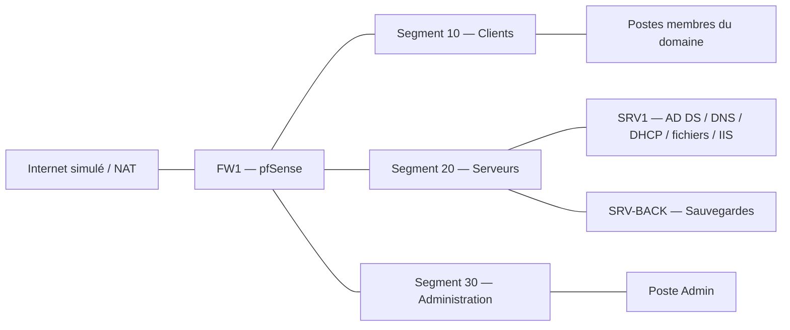

# ArchiTech — Infrastructure informatique d'une PME

Documentation d'un projet pédagogique d'infrastructure pour un cabinet d'architecture et de BTP fictif de 25 collaborateurs. Le projet combine segmentation réseau, services Windows, gestion des comptes et automatisation des sauvegardes.

**Les machines virtuelles sont absentes de ce dépôt.** Aucun disque, instantané, export de VM ni configuration contenant des identifiants n'est fourni. Les procédures décrivent le dossier technique d'origine ; elles n'ont pas été rejouées sur des VM disponibles aujourd'hui.

## Architecture documentée

- VirtualBox pour la virtualisation.
- pfSense pour le routage, le relais DHCP et le filtrage.
- Windows Server 2022 : AD DS, DNS, DHCP, partage de fichiers et IIS.
- Serveur dédié aux sauvegardes, postes clients et poste d'administration.
- Trois segments logiques : clients (10), serveurs (20), administration (30).

## Contenu

| Chemin | Contenu |
|---|---|
| [docs/architecture.md](docs/architecture.md) | Adressage et services du laboratoire |
| [docs/securite-et-limites.md](docs/securite-et-limites.md) | Limites du dossier et améliorations |
| [docs/recette.md](docs/recette.md) | Plan de vérification à rejouer |
| [scripts/backup.ps1](scripts/backup.ps1) | Exemple de sauvegarde remanié sans secret |
| [scripts/README.md](scripts/README.md) | Usage et limites du script |

## Contributions et provenance

Le dossier technique attribue à Arwy07 l'infrastructure réseau, pfSense, les VM et les scripts. Le projet était collectif ; les autres contributions portaient sur les services Windows, la sécurité et la sauvegarde/documentation. Les données nominatives des étudiants ne sont pas reprises.

Cette édition est une synthèse nettoyée du dossier technique local. Le document brut contenait des mots de passe et n'est pas publié. Le script est une adaptation destinée à la présentation et aux essais ; il ne constitue pas un export certifié de la configuration des machines.

## État du projet

Les résultats historiques sont rapportés par le dossier source. La présence de trois réseaux ne prouve pas une isolation effective : le filtrage historique était trop permissif. Consulter les limites avant toute reproduction. Aucune validation actuelle de bout en bout n'est revendiquée.
